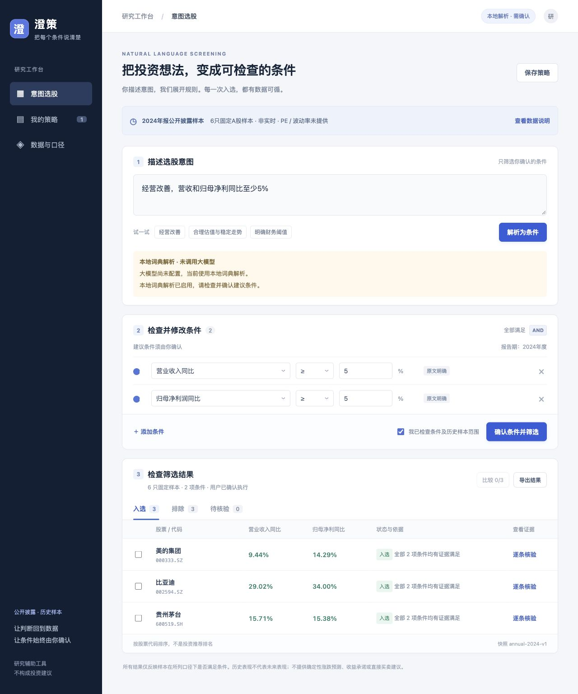

# 澄策 · 自然语言选股与策略解释器

[返回作品集](../../README.md)

一个让投资者检查、修改并确认选股条件的 AI 产品原型：自然语言意图 → 可编辑规则 → 确定性筛选 → 逐股证据解释 → 条件变化比较。

本目录公开完整源码、四份设计文档、可编辑流程图与测试记录，适合作为 AI 产品设计和工程实现作品。



## 快速运行

需要 Node.js 20 或更高版本，无需安装第三方 npm 包。

```sh
cd 源代码
npm run dev
# 打开 http://127.0.0.1:4173
```

验证方式：

```sh
cd 源代码
npm run build
npm test
python3 scripts/audit_evidence.py
```

既有验证记录包含 38 项 Node 自动测试及 12 项财务同比独立复算。具体测试范围、浏览器操作和已知限制见 [测试说明](源代码/TESTING.md) 与 [验证记录](验证记录/VERIFICATION.md)。

## 核心体验

- 将“经营改善”等自然语言转为可检查、可修改的条件；执行前由用户确认。
- 展示入选、排除、待核验三类结果，并逐条解释规则与原始证据。
- 修改阈值后预览同一数据快照的结果变化，比较候选股票、保存策略、导出 JSON/CSV。
- 缺少数据时保留缺口；冲突规则、网络异常和模型异常均有明确兜底。

## 文件导航

| 内容 | 入口 |
| --- | --- |
| 完整工程与运行说明 | [源代码](源代码/README.md) |
| PRD | [Markdown](设计文档/01_PRD.md) · [Word](设计文档/01_PRD.docx) |
| 业务流程 | [Markdown](设计文档/02_业务流程图.md) · [Word](设计文档/02_业务流程图.docx) |
| 产品流程 | [Markdown](设计文档/03_产品流程图.md) · [Word](设计文档/03_产品流程图.docx) |
| 兜底与验收方案 | [Markdown](设计文档/04_兜底与验收方案.md) · [Word](设计文档/04_兜底与验收方案.docx) |
| 可编辑流程图 | [业务流程](流程图/business-flow.drawio) · [产品流程](流程图/product-flow.drawio) |
| 数据证据 | [数据说明](源代码/data/data-notes.md) · [证据 JSON](源代码/data/evidence.json) |
| AI 使用与纠错 | [AI_USAGE.md](源代码/AI_USAGE.md) |
| 原交付背景 | [交付说明](00_交付说明.md) |

## 数据与 AI 边界

当前使用六只 A 股的 2024 年官方年报历史样本，保留原文链接、页码、金额、单位和披露日。当前模式是页面明确标注的本地词典解析；可选的服务端模型接口已实现，但未配置真实模型密钥，未完成在线模型连通验收。

产品未接入实时全市场行情或扶摇/iFinD，PE TTM 与 60 日波动率缺失时保持 `null`。不提供交易执行、买卖建议或历史可交易回测；示例结果不可外推为投资推荐。

## 线上站点与公开范围

此前已部署 [Sites 站点](https://chengce-stock-intent-20261119.ryuuuu314.chatgpt.site)，该站点仍仅项目所有者可访问，需登录对应 ChatGPT 账户。本目录公开的是源码和设计材料；读者可在本地独立运行。本次公开整理不改变原站点权限。

公开副本排除了 `.git`、`.openai`、依赖、构建缓存、托管平台内部标识和重复压缩包。环境变量样例只有空值，真实密钥应由部署者在服务端配置。文件校验值见 [PUBLIC-MANIFEST.json](PUBLIC-MANIFEST.json)。
