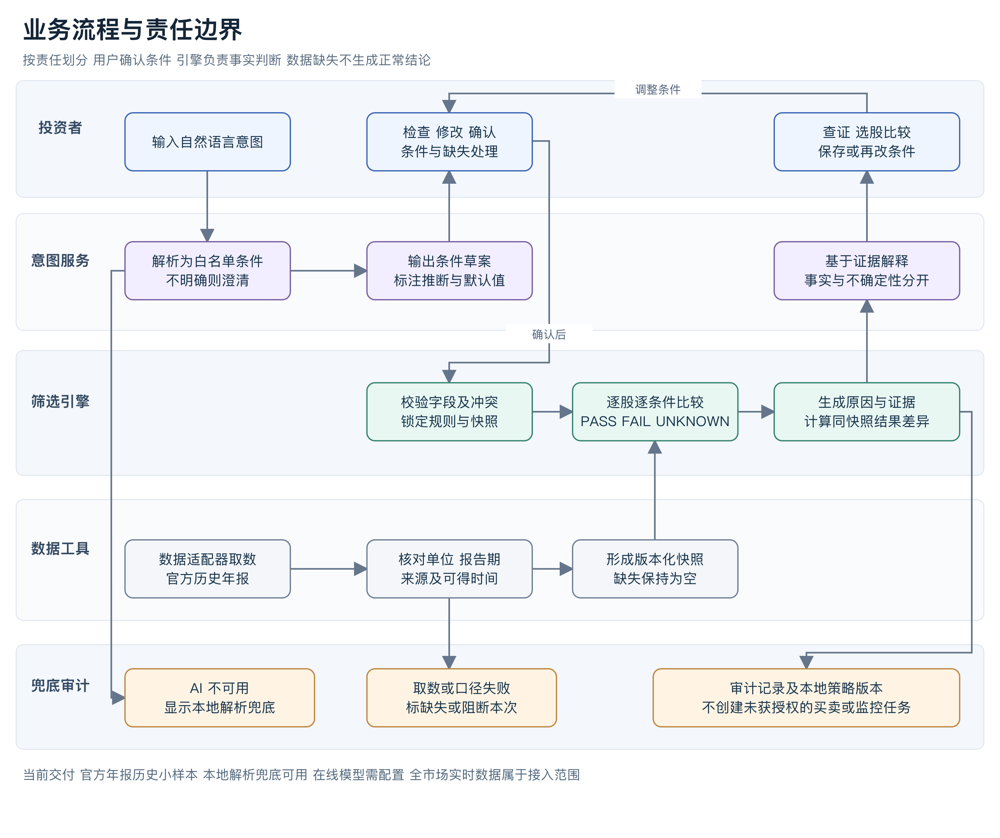

# 自然语言智能选股业务流程

版本 1.0　交付日期 2026 年 11 月 19 日

本流程定义投资者、意图服务、确定性引擎和数据工具如何共同完成一次可核查选股。业务闭环是“提出意图、确认条件、核验数据、执行判断、查证解释、调整复用”。用户确认结构化条件之后才执行，任何入选结论都必须对应有效证据。

## 1 业务流程图

蓝色表示用户决策，紫色表示语言理解与解释，绿色表示确定性判断，灰色表示数据处理，橙色表示异常与留痕。可编辑文件为同目录的 business-flow.drawio；图中的未来数据适配行为详见下文范围说明。

## 2 业务步骤和责任

| 阶段 | 责任主体 | 输入与输出 | 进入下一步的条件 |
| --- | --- | --- | --- |
| 提出意图 | 投资者 | 一句话或示例，输出保留的原文 | 已填写研究意图 |
| 解析与澄清 | 意图服务 | 原文转字段、运算符和阈值草案，显示默认值及未支持表达 | 用户可理解并修改草案 |
| 确认条件 | 投资者与校验器 | 开关、字段、比较符、阈值、统计期；输出确认规则 | 至少一条启用规则，无冲突、非法值或未解决澄清 |
| 准备证据 | 数据工具 | 官方披露原文和归一化字段；输出固定历史快照 | 来源、单位、报告期完整，缺失保持为空 |
| 执行筛选 | 确定性引擎 | 已确认规则与固定快照；输出逐条件判断和互斥结果集合 | 每项判断能回到原始证据 |
| 查验解释 | 投资者与解释层 | 入选、排除、待核验及原因，输出可检查证据 | 事实、代理解释和不确定信息分别呈现 |
| 调整复用 | 投资者 | 新条件版本，输出同快照新增和移除、比较、保存与导出 | 新版本再确认，基线与旧结果保留 |

## 3 关键业务规则

经营改善在本期被代理为年度营业收入同比与归母净利润同比。默认建议均为至少 5%，属于可修改的产品模板，不代表对企业经营质量的完整判断。若用户提出估值合理、走势稳定，再加入正 PE TTM 上限与 60 日年化波动率条件；缺数会影响结果可判断性。

单条件分为 PASS、FAIL、UNKNOWN。所有启用条件按 AND 组合：任一 FAIL 则排除；没有 FAIL 但含 UNKNOWN 则待核验；全部 PASS 才入选。排除股票仍展示其他未知字段，不能用总体排除掩盖证据缺口。

没有股票满足有效条件与没有数据可判断是不同业务结果。前者允许查看排除依据并修改条件；后者先说明数据限制，不通过自动放宽条件掩盖故障。系统不能自动删掉未知条件后声称原意已满足。

## 4 真实样本闭环

当前股票宇宙为人工固定的六只 A 股公开年报样本，报告期为 2024 年，资料集合截至 2025 年 4 月 30 日，采集于 2026 年 11 月 19 日。它用于可追溯的历史财务筛选演示，不覆盖全市场，不代表当前财报或行情。

| 情况 | 固定规则 | 可核查输出 |
| --- | --- | --- |
| 默认筛选 | 营收同比 ≥5%，归母净利同比 ≥5% | 3 入选，3 排除，0 待核验 |
| 放宽营收条件 | 营收同比 ≥4%，归母净利同比 ≥5% | 4 入选，海尔智家由排除转入选 |
| 补充估值与稳定条件 | 默认规则加正 PE TTM ≤30 倍、波动率 ≤30% | 0 入选，3 排除，3 待核验；PE 与波动缺少证据 |

上述计数由固定证据与规则计算得到，属于样本分类，不构成股票推荐。原始数值与来源详见产品证据详情和源码 data/evidence.json。

## 5 实现与后续接入边界

本次实现历史快照、受限本地解析、可选服务端大模型解析、规则校验、三态结果、证据、比较、本地保存和导出。未配置在线模型时明确标记本地解析。数据工具在本次交付中体现为已核验的公开披露快照；实时金融适配器没有取得授权连接，不显示已联网筛选。

实时阶段需由服务端完成授权取数、HTTP 与业务错误双校验、交易日历检查、字段口径映射、质量判定和审计；可得时点不足时仍禁止历史可交易回测。后台监控、交易与收益预测不属于当前执行流程。

