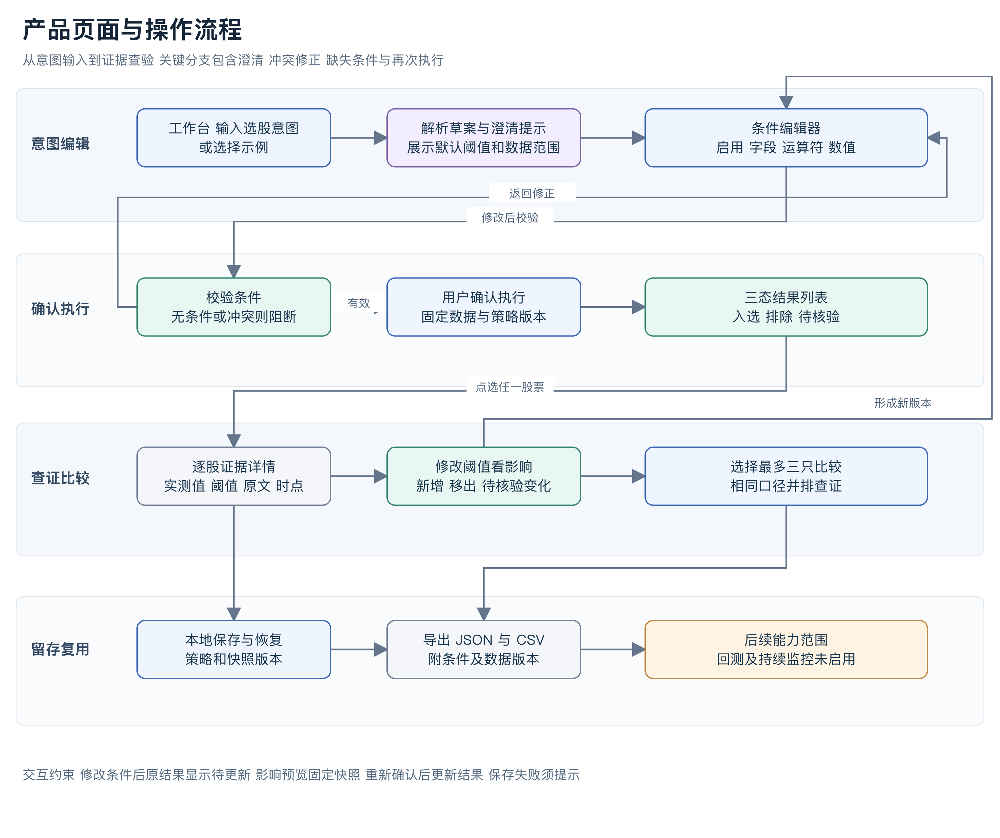

# 自然语言智能选股产品流程

版本 1.0　交付日期 2026 年 11 月 19 日

本流程用于产品评审、交互设计和前端验收，描述投资者在工作台内怎样把意图变成可确认条件，再从结果回到原始证据。主要操作在同一工作台完成，证据和比较以面板展开，减少跳页丢失上下文。

## 1 产品流程图

该图按意图编辑、确认执行、查证比较、留存复用四个阶段展示。证据、影响预览、比较、保存和导出是结果后的可选操作，不要求逐项完成。可编辑文件为 product-flow.drawio。

## 2 页面与操作

| 页面区域 | 用户操作 | 系统反馈 |
| --- | --- | --- |
| 工作台和意图区 | 输入自然语言或选择示例并解析 | 显示解析方式、支持内容、建议阈值、澄清与数据范围 |
| 条件编辑器 | 修改字段、运算符、数值或启停条件 | 即时校验，解释字段口径与缺失，保留原意 |
| 确认执行区 | 审核当前条件后执行 | 固定本次条件与快照，展示运行结果；无条件或冲突时阻断 |
| 结果区 | 切换入选、排除和待核验 | 数量相加等于六只样本，每只展示判断与入口 |
| 证据面板 | 打开任一股票的理由 | 展示逐条件值、阈值、通过状态、原文链接、页码、报告期及披露日期 |
| 影响预览 | 在原结果基础上修改条件 | 同一快照重算预览，显示新增、移除和待核验变化；确认后更新正式结果 |
| 比较面板 | 选择最多三只股票 | 用同一字段和口径并排比较，未知值保持未知 |
| 策略留存 | 保存、恢复、导出 JSON 或结果 CSV | 标注本地存储，保存失败提示；导出附规则、快照和证据 |

## 3 状态转换与退出条件

待输入状态只有填写意图才进入解析。解析完成进入待确认；含不支持逻辑或不明确表达时先澄清。用户能通过改写输入或手工编辑支持的条件解决澄清，不能由系统静默丢弃原要求。

待确认状态允许编辑。校验失败时展示错误并保留其余内容。合法条件经用户确认后进入执行；成功后进入结果状态。条件变动时旧结果仍属于上次执行，需提示待更新，并提供基于相同快照的影响预览；只有再次确认后才将新条件设为正式结果。

保存与恢复不代表后台定时运行。恢复时比较快照版本；版本不匹配不能把旧结果冒充当前结果。当前没有创建回测或持续监控任务的入口，不生成模拟任务成功提示。

## 4 三个端到端演示脚本

### 4.1 检查经营改善

输入“经营改善，营收和归母净利同比至少5%”，解析后检查两条条件，确认执行。查看三个入选和三个排除；打开海尔智家证据，核对营业收入同比 4.29% 低于门槛、归母净利同比 12.92% 通过门槛。原文使用 2023 年调整后营业收入口径，证据备注应可见。

### 4.2 检查条件变化

保留默认筛选结果，将营业收入同比门槛从 5% 改到 4%。预览应显示海尔智家新增入选，入选数从 3 变为 4；原结果在确认前保留。确认后选择两只股票比较，再保存策略。该变化只说明历史条件分类，不说明未来收益变化。

### 4.3 检查缺失与冲突

输入“经营改善、估值合理、走势相对稳定”，检查建议条件后执行。PE 与波动证据为空，财务通过的三只进入待核验，财务失败的三只仍为排除。将同一 PE 字段设置为大于 30 且小于 20，系统应阻断执行并定位矛盾；用户修正后再执行。

## 5 展示与交互标准

桌面布局使用侧栏工作区和主内容区，关键日期、历史模式和数据范围始终可发现。窄屏纵向排列输入、条件和结果，表格保留滚动或转为卡片。状态不能只靠颜色区分，必须显示文字。

输入、按钮、开关、字段选择和对话框使用可访问名称；键盘可操作主链路，焦点随面板打开与关闭返回合理位置。错误靠近出错操作，同时给出可继续的路径。加载态防止重复提交，不因解析或取数失败清空原文。

这些是产品验收规格。实际自动化与浏览器验证结果分别记录于源码 TESTING.md 和交付验证记录，不能将规格当成已通过的测试。

